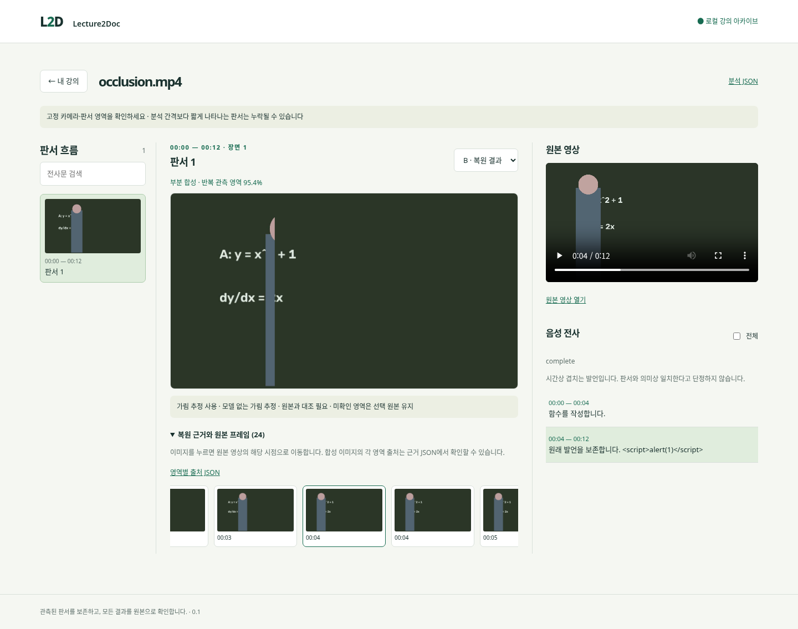

# Lecture2Doc

강의 영상을 분석해 판서가 완성되는 흐름을 기록하고, 각 결과를 원본 영상과 확인하는 로컬 웹 앱입니다. 누적 판서를 구간별로 정리하고(A), 같은 판서 상태의 여러 관측에서 가려진 부분을 보완하며(B), 판서 이미지에서 문자를 인식합니다(C). A/B와 OCR은 CPU에서 로컬로 실행합니다.

현재 버전은 **V1 = A + B + C(OCR)**입니다. 음성 전사와 자막 입력도 선택 기능으로 제공하며, 수식의 LaTeX 변환과 강의 노트 작성은 아직 포함하지 않습니다. 기능과 실험 결과는 아래 문서에서 확인할 수 있습니다.

## 빠른 시작

### 요구 사항

- Python 3.11 이상
- FFmpeg와 `ffprobe`
- Bash 셸(Linux/macOS 또는 Windows WSL)

### 설치 및 실행

저장소 루트에서 다음을 실행합니다.

```bash
python3.11 -m venv .venv
source .venv/bin/activate
python -m pip install -e '.[ocr]'
lecture2doc ocr-models --language en
./serve.sh
```

모델 준비 단계에서 OCR 모델을 내려받습니다. 한글·영문 판서에는 `lecture2doc ocr-models --language ko`를 실행하고, 웹 화면에서 분석 언어를 선택하세요. 이후 OCR 추론은 로컬에서 실행됩니다. 앱은 `http://127.0.0.1:8765`에서 열립니다. `./serve.sh --port 8888`로 포트를 바꿀 수 있고, `./serve.sh --no-browser`는 브라우저를 자동으로 열지 않습니다. 서버 종료는 실행한 터미널에서 `Ctrl+C`입니다.

`ffmpeg`와 `ffprobe`는 운영체제 패키지 관리자로 설치합니다. MP4V·MKV 등 브라우저에서 재생하기 어려운 영상은 H.264/AAC 사본을 만들 수 있습니다. 이때 FFmpeg 빌드에 `libx264`와 AAC 인코더가 필요합니다.

### 첫 영상 등록

웹 화면에서 영상을 등록합니다. 업로드 영상과 분석 결과는 저장소의 `data/`에 생성되며 Git에서 제외됩니다. 자막이 있으면 SRT, VTT 또는 지원되는 JSON 파일을 함께 넣을 수 있습니다. Whisper 전사를 사용하려면 아래 선택 설치를 확인하세요.

## CLI 사용

```bash
# 자막을 사용한 판서 기록
lecture2doc process lecture.mp4 --out data/my-lecture \
  --subtitles lecture.srt --board auto

# 기존 기록에 OCR 추가
lecture2doc ocr data/my-lecture --language en

# 기존 분석 결과를 웹에서 열기
lecture2doc serve --record data/my-lecture
```

영상 처리에는 기본적으로 0.5초 관측 간격을 사용합니다. 더 촘촘한 관측은 `--sample-seconds 0.25`, 칠판 영역 지정은 `--roi x,y,w,h`(영상 크기에 대한 0~1 비율), A/B 외에 C를 생략하려면 `--ocr off`를 사용할 수 있습니다. 전체 명령 옵션과 결과 파일 구조는 [사용 안내](docs/USER_GUIDE.md)를 참고하세요.

## 선택 기능

### 음성 전사

```bash
python -m pip install -e '.[stt]'
lecture2doc process lecture.mp4 --out data/my-lecture \
  --model small --language ko --allow-download
```

Whisper는 CPU에서 실행합니다. 공개 모델의 첫 다운로드에만 네트워크가 필요합니다. 모델은 기본적으로 `models/whisper/`에 두며 이 폴더는 Git에서 제외됩니다. `LECTURE2DOC_WHISPER_MODELS` 환경 변수로 다른 저장 위치를 지정할 수 있습니다. `tiny`, `base` 같은 이름이나 로컬 CTranslate2 모델 폴더를 사용할 수 있습니다.

### OCR 모델 위치

OCR 모델은 기본적으로 `models/ocr/`에 저장되며 Git에서 제외됩니다. 저장 위치는 `LECTURE2DOC_OCR_MODELS`로 바꿀 수 있습니다. 설치 직후 모델 준비 명령을 실행해야 OCR을 사용할 수 있습니다.

## 구조

```text
lecture2doc/       영상 분석, A/B/C 처리, 로컬 웹 서버와 화면
scripts/           평가·진단·실험 실행 도구
tests/             단위 및 시스템 테스트
docs/              사용 안내, 아키텍처, 설계·평가 보고서
experiments/       실험 결과, 비교 자료, 실행 기록
research/          OCR·관련 구현 조사 자료
models/            모델 사용 안내와 해시 인덱스(가중치는 별도 준비)
data/              로컬 업로드·처리 결과(Git 제외)
```

일반적인 처리 흐름은 다음과 같습니다.

```text
영상 → 프레임·시간 정보 추출 → 판서 구간과 후보 분석(A)
     → 완성 판서별 원본 선택(A) → 필요할 때 관측 기반 복원(B)
     → 선택된 판서 이미지의 OCR(C) → 원본 근거와 함께 웹에서 탐색
```

핵심 코드:

- `lecture2doc/pipeline.py`: 단계 연결, 캐시, 진행 상태
- `lecture2doc/pages.py`: 누적 판서 구간과 대표 원본 선택(A)
- `lecture2doc/page_restore.py`: 같은 판서 상태에서의 부분 복원(B)
- `lecture2doc/ocr.py`: OCR 모델, 텍스트 영역, 원본 crop(C)
- `lecture2doc/transcript.py`: 자막과 선택적 Whisper 전사
- `lecture2doc/server.py`, `lecture2doc/static/`: 로컬 API와 웹 UI
- `lecture2doc/launcher.py`, `serve.sh`: 저장소 위치를 기준으로 앱 실행

## 개발

```bash
python -m pip install -e '.[test]'
python -m pytest -q
```

OCR과 음성 전사는 각각 `.[ocr]`, `.[stt]` 선택 의존성입니다. 고정된 개발 의존성 전체는 `requirements-lock.txt`와 `requirements-ocr-lock.txt`를 참고하세요.

## 문서

- [사용 안내와 CLI 옵션](docs/USER_GUIDE.md)
- [아키텍처와 데이터 계약](docs/ARCHITECTURE.md)
- [개발 범위와 로드맵](docs/ROADMAP.md)
- [A/B 개선 보고서와 최신 결과](docs/AB_REFINEMENT.md)
- [V1 OCR 구현과 실행 결과](docs/V1_OCR.md)
- [검증 기록과 남은 한계](docs/VALIDATION.md)
- [AccessMath 재현 및 비교](docs/ACCESSMATH.md)
- [문서·실험 인덱스](docs/)
- [제3자 구성 요소와 라이선스](THIRD_PARTY.md)

## 라이선스

프로젝트 자체의 라이선스는 아직 지정되지 않았습니다. 제3자 라이브러리와 모델의 출처·라이선스는 [THIRD_PARTY.md](THIRD_PARTY.md)에 정리되어 있습니다.


