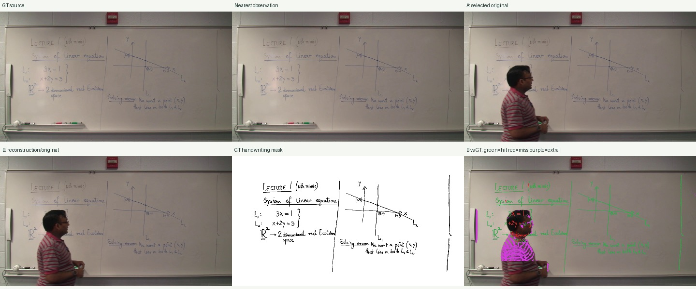
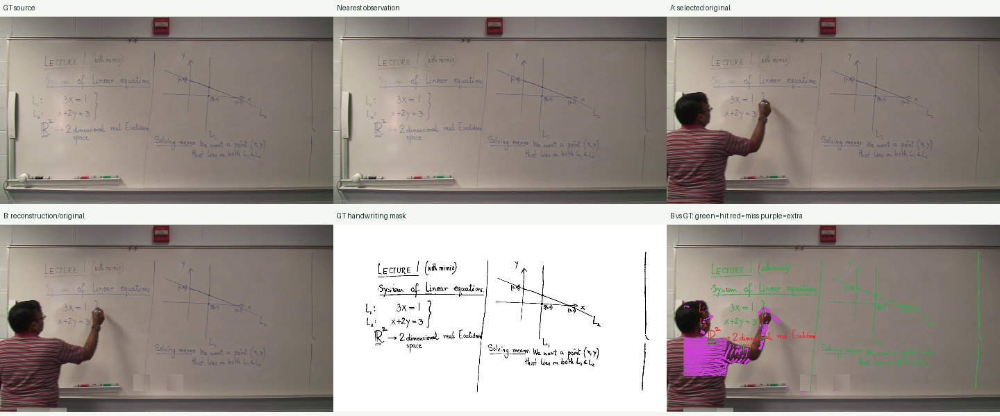

# AccessMath 실행 및 정답 비교 · 2026-11-01

**현재 구현의 B단계 복원 품질이 충분하다는 근거를 얻지 못했습니다.** 기본 설정의 정답 시점 판서 픽셀 회수율은 평균 96.42%였으나 B단계 개선이 없었습니다. 화이트보드를 지정한 실행도 개선은 약 0.08%p에 그쳤습니다. 가림 없는 원본을 추출하고도 가려진 이미지를 대표로 선택하는 실패와 교수자 잔상이 실제 데이터에서 확인됐습니다.

## 입력과 고정 조건

- 공식 출처: [RIT DPRL 배포 페이지](https://cs.rit.edu/~dprl/software.html), [영상 디렉터리](https://www.cs.rit.edu/~accessmath/am_videos/lectures/Lecture_01/), [정답 주석 ZIP](https://www.cs.rit.edu/~rlaz/files/tangent-v/AccessMath_ICDAR_2017_data.zip).
- 파일: `AccessMath_lecture_01_part_1.mp4` **전체**, 1,025,281,084바이트, 1920×1080, 약 29.97fps, 1046.078초(17분 26초), H.264/AAC. 잘 나온 짧은 구간을 선택하지 않았습니다.
- 영상 SHA-256: `f9dacbb0950737985408437fc8569a27478abef1f2d6370f54d960783a0762d2`.
- 공식 **training 분할**입니다. 모델 학습·파인튜닝은 수행하지 않았습니다. 테스트 분할 일반화 점수나 전체 데이터셋 벤치마크 점수로 보고하지 않습니다.
- 범위 내 공식 키프레임: 347.781초, 607.674초, 730.530초의 **3개**. Lecture 01 전체 7개 중 이후 파트의 4개는 제외했습니다.
- 앱 소스 해시: [baseline-code.json](../experiments/accessmath/baseline-code.json). 이번 실행 중 핵심 알고리즘을 수정하지 않았습니다.
- 기본 실행: 관측 0.5초, 분석 폭 640, 전체 ROI, `board=auto`, 확인 2회, 타일 32. 두 번째는 **`board=whiteboard`만 변경**했습니다. GT는 앱 입력으로 사용하지 않았습니다.
- 이번 실험은 판서 선택·복원 평가이며 음성 전사는 실행하지 않았습니다.

## 결과

두 실행 모두 원본 해상도 PNG 관측 **2,090개**를 사용했습니다. 두 번째 실행은 같은 PNG를 하드링크로 재사용했습니다.

| 설정 | 판서 상태 | 부분 합성 / 원본 제공 | A 회수율 | B 회수율 | A / B 정밀도 | A / B F1 |
|---|---:|---:|---:|---:|---:|---:|
| 기본 auto | 141 | 84 / 57 | 96.42% | 96.42% | 74.24% / 74.24% | 83.28% / 83.28% |
| whiteboard 지정 | 65 | 43 / 22 | 91.49% | 91.58% | 54.51% / 54.56% | 68.21% / 68.27% |
| 정답 시각에 가장 가까운 관측 원본 | — | — | 99.53% | — | 94.30% | 96.84% |
| 정답 원본 자체의 이진화 기준값 | — | — | 99.56% | — | 94.32% | 96.87% |

표는 진단 평가 임계값 10, 키프레임 3개의 **macro 평균**입니다. `partial`은 타일을 다른 관측에서 복사했다는 코드 상태이며 판서 복원 성공 판정으로 사용하지 않았습니다. 기본 84건의 부분 합성 중 평가한 정답 시점에서는 A보다 B가 개선됐다는 근거를 얻지 못했습니다. 나머지 시점의 품질은 이 점수로 판단하지 않습니다.

첫 실행은 약 **289.3초**, whiteboard 지정은 디코딩 캐시를 재사용해 **150.8초**였습니다. 작업 환경 CPU에서 실행했고 Intel 268V 실측은 아닙니다. 캐시와 실행 부하가 달라 속도 비교로 사용하지 않습니다.

## 평가 계약

공식 `segments.xml`의 `AbsTime`(밀리초)에서 각 GT 시각이 속하는 앱 상태를 선택해 그 상태의 A와 B를 평가했습니다. GT와 가장 잘 맞는 요약 이미지를 사후 선택하는 oracle 방식은 사용하지 않았습니다. 가장 가까운 관측 원본은 별도 대조군입니다.

컬러 출력은 평가 단계에서 동일한 이진화를 적용했습니다: 31×31 타원 black-hat, 임계값 **10/20/30**, 원본 GT 크기, 3픽셀 위치 허용. 공식 비판서 영역 주석만 제외했습니다. 사람 마스크는 평가에 사용하지 않아 옷·팔·잔상이 추가 잉크로 검출될 수 있습니다. 정답 원본에도 같은 처리를 적용해 이진화 자체의 오차를 보여줍니다.

회수율은 정답 필기 픽셀 중 허용 거리 내 결과 필기가 있는 비율, 정밀도는 검출 필기 중 정답에 대응하는 비율입니다. 면적 10픽셀 이상 GT 연결 요소 중 80% 이상 대응하는 요소 비율도 저장했습니다. 이는 **공식 unique-CC summary 점수, OCR 정확도, 인간 가독성 점수가 아닙니다.** 모든 임계값 결과를 JSON에 공개했습니다.

GT 원본과 가장 가까운 영상 관측의 위치 차이는 960×540 축소 영상에서 최대 약 0.03픽셀이었습니다. GT 구간 경계는 첫 파트 FPS로 변환하고, 범위 내 세 `AbsTime`과 1ms 이내 일치하는지 검사했습니다. 이후 파트의 시간 관계를 첫 파트에 적용하지 않았습니다.

## 확인한 실패

### 가림 없는 관측이 있는데 대표 선택 실패

607.674초의 가장 가까운 607.607초 관측은 교수자가 물러나 판서가 드러납니다. 기본 설정은 **616.1155초** 이미지를 대표로 선택해 왼쪽을 교수자가 가렸고, B는 원본 제공으로 끝났습니다. A/B 회수율은 약 93.02%, 정밀도는 약 60.43%였습니다.



원본 추출 성공과 대표 선택 품질이 별개임을 보여줍니다. 추출 원본은 모두 데이터와 웹 뷰어에 남아 있습니다.

### whiteboard 지정도 복원 품질을 해결하지 못함

자동 판별은 2,090개 중 **2,087개**를 blackboard로 분류했습니다. whiteboard 지정은 이 오류를 피하고 상태 수를 줄였지만 대표 선택·복원 품질은 개선하지 못했습니다.

607.674초가 속한 상태는 **606.1055~670.670초**, 대표는 **663.1625초**였습니다. 정답 구간 경계를 가로지르는 긴 상태에서 가림과 갱신을 충분히 추적하지 못했고 부분 합성에 교수자 머리·몸·팔 잔상이 남았습니다. 회수율은 85.81%→85.95%로만 변했고 F1은 약간 하락했습니다.



### 이동 검출 불안정

두 실행 모두 이동 경계를 19회 검출했습니다. 같은 phase correlation을 상단 1/4에만 적용한 별도 진단에서는 19회 중 18회의 상단 이동이 2 분석 픽셀 미만이었습니다. 사람 움직임에 반응했을 가능성이 있습니다. 이 진단은 수동 이동 정답이 아니므로 정확한 오검출률로 보고하지 않습니다. [진단 수치](../experiments/accessmath/motion-diagnostic.json)를 남겼습니다.

## 결과 열기

- [두 설정 비교 HTML](../experiments/accessmath/index.html)
- [기본 설정 비교](../experiments/accessmath/evaluation/index.html), [전체 JSON](../experiments/accessmath/evaluation/report.json)
- [whiteboard 지정 비교](../experiments/accessmath/evaluation-whiteboard/index.html), [전체 JSON](../experiments/accessmath/evaluation-whiteboard/report.json)
- [출처·입력 해시·설정](../experiments/accessmath/dataset-provenance.json)
- [웹 뷰어 캡처](../experiments/accessmath/viewer-607s.png)

현재 보고서는 [localhost:8767](http://127.0.0.1:8767/), 원본 영상과 연결된 기본 결과 뷰어는 [localhost:8766](http://127.0.0.1:8766/)에서도 볼 수 있습니다.

## 재현

```bash
source .venv/bin/activate
python scripts/accessmath_run.py --download
# 입력과 완료 결과가 있으면 다운로드 없이 재사용, 최초 처리 시간 유지
python scripts/accessmath_run.py
python scripts/accessmath_motion_check.py
python -m pytest tests/test_accessmath_evaluation.py -q
lecture2doc serve --record experiments/accessmath/lecture01_part1 --port 8766
python -m http.server 8767 --bind 127.0.0.1 --directory experiments/accessmath
```

입력·GT는 `datasets/accessmath/`, 결과·출처는 `experiments/accessmath/`에 저장했습니다. 다운로드는 범위별 재개를 지원합니다. 평가 구현의 회수율/정밀도 구분, 허용 거리·제외 영역, GT 밀리초·흑색 필기 규약은 작은 정답 예제 **3개 테스트를 통과**했습니다. 테스트 통과는 실제 판서 품질 점수와 별개입니다.

실제 데이터에서 확인된 수정 우선순위는 가림 적은 프레임의 순위 결정, 필기와 연결되는 전경 마스크, 사람에 흔들리는 이동 판정, 긴 상태의 갱신·삭제 추적입니다. 이를 수정한 후 같은 자료에 회귀 평가하고, 공식 testing 분할과 나머지 강의 파트로 확대해야 합니다. 이번에는 기준 실행을 남기기 위해 앱 알고리즘을 바꾸지 않았습니다.
