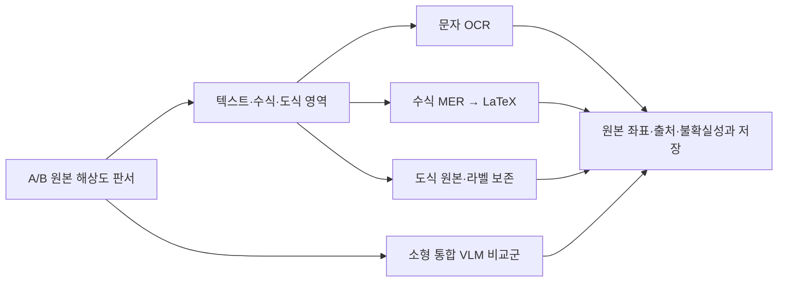

# C 서베이 — 강의 판서 OCR·수식 인식

현재 개발 범위는 **V1의 C = OCR**이며 수식→LaTeX는 후속 목표로 옮겼다. 아래는 범위 변경 전의 OCR·수식 후보 조사다. [최신 범위](ROADMAP.md), [OCR 구현·실행](V1_OCR.md).

조사일: **2026-11-02**. 범위는 C의 OCR과 수식→LaTeX다. 전사 보정·강의 노트·편집 기능은 D로 둔다.

추가 조사: [손필기 OCR의 실사용 가능성](HANDWRITING_OCR_SURVEY.md). 영문·한글 공개 결과와 실제 판서 적용 조건을 비교하고, **OCR 우선 구현 / LaTeX 후속 목표 / 이미지 입력 API 비교** 방향을 제안했다.

실사용 판단과 수식 전체 정답률은 [4.1절](#41-인식-정확도와-실사용-판단)에 정리했다. 개별 수식 추출을 먼저 시험하고, 판서 전체 자동 LaTeX 변환은 우선순위를 낮춘다.

논문·공식 모델 카드·추론 코드·라이선스를 비교했다. 표의 성능 수치는 저자 공개 결과다. 후속 실험에서는 실제 판서 crop으로 인식 품질과 실행 시간을 측정한다.

## 1. 판단

**단일 모델로 수식 이미지를 LaTeX로 바꾸는 것은 이미 가능하다.** UniMERNet·PP-FormulaNet·Uni-MuMER가 그 유형이다. 일반 OCR로 먼저 문자를 읽고 나중에 LLM이 수식 문법을 붙여야만 하는 문제는 아니다. 다만 **판서 전체**의 문장·수식·행렬·도식을 구분하고, 작은 필기까지 빠짐없이 인식하는 문제는 별개다. HMER 연구는 전통적인 기호 분리·분류·공간 관계·구조 분석에서 이를 함께 학습하는 encoder–decoder/GNN으로 발전했다. [HMER 서베이](https://www.cs.rit.edu/~rlaz/files/PRec2024_handwritten_math_recognition_survey.pdf), [UniMERNet](https://arxiv.org/abs/2404.15254).

먼저 다음 두 경로를 비교한다.

- **분리형:** 판서 영역 분리 → 문장은 OCR, 수식 블록은 MER → 각 결과를 이미지 좌표와 연결.
- **통합형:** 소형 문서 VLM으로 텍스트·수식을 함께 추출 → 누락·좌표·원본 일치를 별도로 검증.

분리형은 오류 원인을 영역 검출/인식으로 나누고 CPU 비용을 조절하기 쉽다. 통합형은 혼합 문맥에 유리할 수 있지만 실제 판서에서의 누락·재작성 여부를 확인해야 한다. 

## 2. 실제 입력의 난점

입력은 PDF 조판 수식이 아니라, 압축·그림자·기울기·희미한 펜·인물 잔여 부분이 있는 강의 사진이다. 인식은 A/B의 원본 해상도에서 시작해야 하며 A/B 분석용 640픽셀 마스크를 인식 이미지로 쓰면 안 된다.

[실제 원본 crop 6개와 RGB/회색/적응 이진화 비교](../research/ocr-survey/examples/index.html)를 만들었다. 출처 프레임, 시각, 좌표, 이미지 해시는 [example-index.json](../research/ocr-survey/example-index.json)에 있다.

확인할 문제는 다음과 같다.

- `x`, 곱셈 표시, `1/l`, `0/O`, 아래첨자·윗첨자·벡터 표시의 혼동.
- 행렬을 줄별 OCR로 찢으면 괄호, 행/열, augmented-matrix 구분선이 사라지는 문제.
- 설명 문장 속 `L₁`, `(x,y)` 같은 inline math. 문장 전체를 수식 모델에 넣는 것도, 수식을 일반 문자로만 읽는 것도 위험하다.
- 좌표축·화살표·그래프의 선을 분수선/수식으로 오인하는 문제. C에서는 도식 원본과 글자 라벨을 보존하고 그래프 의미를 추론하지 않는다.
- 실제 한국어 손글씨. AccessMath 예시는 영어 중심이므로 한글 필기 품질을 검증할 수 없다.

이진화는 **옵션으로 비교**한다. 예시에서는 일부 식이 선명해지지만 희미한 문장 획이 끊기기도 한다. 따라서 RGB를 보존하고 RGB/회색/조명 보정/이진화를 같은 crop에서 비교해야 한다. 이진화만으로 인물과 글씨를 완전히 분리하거나 가려진 내용을 복구한다고 가정하지 않는다.

## 3. 일반 OCR 후보

| 후보 | 확인한 역할·근거 | 프로젝트에서의 위치 |
|---|---|---|
| **PP-OCRv6 small/medium** | 검출+문자열 인식. 공식 표가 영문/중문 손글씨를 별도 평가하며 Intel CPU 배포를 안내 | 일반 문장 OCR의 첫 비교군. small/medium 정확도·시간을 함께 측정 |
| **korean_PP-OCRv5_mobile_rec** | 공식 한국어 체크포인트. 한글 모델을 별도로 명시할 수 있음 | 한국어 실험용. 한국어 지원과 한글 **판서** 정확도는 구분 |
| **TrOCR handwritten** | IAM 기반 한 줄 인식. 입력은 잘린 text-line이며 전체 판서 검출기가 아님 | 영어 손글씨 줄의 기준선. 한국어·행렬·판서 전체의 기본 엔진으로 선정하지 않음 |
| **Tesseract** | 공식 FAQ도 인쇄 문자 중심이며 손글씨에 약하다고 명시 | 설치가 가벼운 하한 비교군 정도. 주 인식 후보에서 제외 |

PP-OCRv6의 저자 내부 평가에서 medium의 영문 손글씨 인식은 67.8%, 인쇄 영문은 94.1%다. 같은 모델에서도 손글씨와 인쇄물의 차이가 크다. 한국어 v5 카드의 88.0%는 해당 평가셋의 문장 완전 일치 지표다. [PP-OCRv6 공식 문서](https://www.paddleocr.ai/latest/en/version3.x/algorithm/PP-OCRv6/PP-OCRv6.html), [한국어 모델 카드](https://huggingface.co/PaddlePaddle/korean_PP-OCRv5_mobile_rec), [TrOCR 모델 카드](https://huggingface.co/microsoft/trocr-base-handwritten), [Tesseract FAQ](https://github.com/tesseract-ocr/tessdoc/blob/main/FAQ.md).

이번에 확인한 v6 small 카드의 언어 메타데이터는 en/zh이고, 한국어는 별도 v5 체크포인트를 후보로 기록했다. 실제 언어별 모델 선택은 버전을 고정해 확인해야 한다. [고정된 모델 카드 목록](../research/ocr-survey/model-card-index.json).

## 4. 수식 전용 MER 후보

| 후보 | 입력/출력·근거 | 로컬 실행·한계 | 우선순위 |
|---|---|---|---|
| **UniMERNet small** | 잘린 수식 이미지→LaTeX. UniMER에는 인쇄/화면 캡처/손글씨 구분이 있음 | 공식 demo에 CPU fallback 존재. 구형 Transformers 고정 및 여러 의존성이 있어 분리 환경 필요 | CPU 수식 기준선 1순위 |
| **PP-FormulaNet_plus-M/L** | 잘린 수식→LaTeX, 복잡한 식 대상. Paddle 수식 pipeline은 layout 검출과 인식을 분리 가능 | 공식 CPU 경로가 있으나 프레임워크·모델 버전 고정 필요. 복잡한 손글씨는 판서 표본으로 비교 | UniMERNet과 비교 |
| **Uni-MuMER Qwen3-VL-2B** | 손글씨 수식에 특화해 미세조정한 공개 모델. 구조·기호 오류를 다루는 학습 | 공개 batch 코드는 vLLM/BF16·GPU 중심. Intel CPU/Arc용 실행 경로 확인 필요 | 손글씨 정확도 중심 비교군 |
| **pix2tex / LaTeX-OCR** | 수식 crop→LaTeX, CPU 선택 코드·자동 크기 조정 있음 | README의 데이터는 조판 중심이고 손글씨 지원은 미완성 항목으로 남음 | 재현 가능한 조판 기준선. 주 손글씨 후보 아님 |
| **CoMER / PosFormer** | coverage·공간 구조를 다루는 HMER 연구 계열 | 강의 전체 검출·한글 문장 처리와 별개. CoMER는 저장소가 archive됨 | 연구 배경/추가 기준선 |

공식 근거: [UniMERNet](https://github.com/opendatalab/UniMERNet), [small 가중치 카드](https://huggingface.co/wanderkid/unimernet_small), [Paddle 수식 모듈](https://www.paddleocr.ai/main/en/version3.x/module_usage/formula_recognition.html), [Uni-MuMER](https://github.com/BFlameSwift/Uni-MuMER), [2B 가중치](https://huggingface.co/phxember/Uni-MuMER-Qwen3-VL-2B), [pix2tex](https://github.com/lukas-blecher/LaTeX-OCR), [CoMER](https://github.com/Green-Wood/CoMER), [PosFormer](https://github.com/SJTU-DeepVisionLab/PosFormer).

주의할 비교 사례: Uni-MuMER의 공개 Qwen3-VL-2B 결과는 CROHME 2014 ExpRate 83.27%, MathWriting 50.66%로 데이터셋에 따라 다르다. 이들은 같은 저자의 공개 표 안에서 읽은 값이며, 다른 모델의 BLEU·문서 전체 점수와 순위를 직접 비교하지 않는다. 새 모델을 학습할 계획은 없으며 공개 체크포인트의 적용 가능성만 조사했다. [버전 고정 README](https://github.com/BFlameSwift/Uni-MuMER/blob/85732e04f60fcf7b26bcea9234fdb43c90ab1591/README.md).

PP-FormulaNet의 S 계열은 비용 비교용으로는 유용하나, 이름이 작다는 이유로 복잡한 손글씨 행렬의 기본값으로 정하지 않는다. 공식 원형 설명에서도 S는 간단한 인쇄식, L은 복잡한 식/손글씨를 구분한다. [공식 설명](https://github.com/PaddlePaddle/PaddleOCR/blob/main/docs/version2.x/algorithm/formula_recognition/algorithm_rec_ppformulanet.md).

## 4.1 인식 정확도와 실사용 판단

**현재 판단: 개별 수식의 LaTeX 추출은 보조 기능으로 시도할 가치가 있다. 판서 전체를 수정 없이 문서로 바꾸는 기능은 우선순위를 낮춘다.** 원본 판서 이미지를 주 결과로 두고, 쓸 만한 수식 인식 결과를 추가하는 구성이 이 프로젝트에 맞다.

### 어느 숫자를 봐야 하나

사용자가 궁금한 “수식 100개 중 몇 개를 바로 쓸 수 있나”에는 **ExpRate: 수식 전체 정답률**이 가장 가까운 지표다. 기호·첨자·배치가 하나라도 달라지면 그 식은 오답으로 센다. LaTeX 표기가 달라도 같은 모습으로 렌더되는 경우는 **CDM 기반 전체 정답률**로 함께 본다.

BLEU, 문자 오류율(CER), 평균 CDM은 부분적으로 얼마나 맞는지를 보여준다. 예를 들어 수식 인식 문서에 나오는 **BLEU 92점은 수식 100개 중 92개가 정확하다는 뜻이 아니라, 토큰 조합의 유사도 점수**다. [ExpRate 정의](https://arxiv.org/html/2404.15254v2), [Paddle 수식 모델의 지표 표](https://www.paddleocr.ai/main/en/version3.x/module_usage/formula_recognition.html).

### 공개 손글씨 수식 결과

같은 Uni-MuMER Qwen3-VL-2B 체크포인트의 공개 평가를 데이터셋별로 보면 다음과 같다.

| 입력/데이터셋 | 식 개수 | 수식 전체 정답률 ExpRate | 렌더 비교 기반 전체 정답률 |
|---|---:|---:|---:|
| 손글씨 CROHME 2014 | 986 | **83.27%** | 86.50% |
| 손글씨 CROHME 2023 | 2,300 | **70.96%** | 78.70% |
| 손글씨 HME100K | 24,607 | **69.31%** | 72.40% |
| 손글씨 MathWriting | 7,643 | **50.66%** | 69.00% |
| 중첩 구조 MNE-N3 | 1,464 | **52.39%** | 72.80% |
| 조판 수식 Im2LaTeXv2 | 10,118 | **77.11%** | 92.60% |

출처: [저자 공개 결과·고정 버전](https://github.com/BFlameSwift/Uni-MuMER/blob/85732e04f60fcf7b26bcea9234fdb43c90ab1591/README.md#benchmark-results). 해당 표는 vLLM 0.19.0, temperature=0.2, 최대 출력 2048토큰 조건을 명시한다. 마지막 행은 조판 수식이며 손글씨와 구분했다.

다른 계열의 기준으로 PosFormer 논문의 경량 HMER 모델은 scale augmentation 적용 시 CROHME 2014/2016/2019에서 각각 **62.68 / 61.03 / 64.97%**, HME100K에서 **69.51%**의 ExpRate를 보고했다. [PosFormer, 표 1·2](https://arxiv.org/html/2407.07764v1#S4.T1).

따라서 “LaTeX 인식은 보통 몇 %인가”에는 **공개 손글씨 평가의 대표 예가 수식 전체 기준 약 50~84%에 걸쳐 있다**고 답하는 것이 적절하다. 데이터 분포, 학습 데이터와 정규화 방식이 이 차이에 영향을 준다. 강의 사진은 여기에 영역 검출, 영상 압축, 그림자 문제가 추가되므로 실제 판서 표본으로 판단한다.

**평균 점수와 전체 정답률의 차이는 크다.** Uni-MuMER 논문의 HME100K 동일 실험(외부 데이터 사용)은 평균 CDM **97.33점**, 렌더 비교 기반 전체 정답률 **73.67%**, ExpRate **71.93%**다. “97점”만 보면 거의 완벽해 보이지만, 식 전체로는 약 네 개 중 하나에 차이가 남는다. [논문 표 12](https://arxiv.org/html/2505.23566v2#A4.T12).

### 연립방정식·행렬·팩토리얼은 어떻게 다른가

| 항목 | 인식에서 중요한 부분 | 이 프로젝트에서 확인할 오류 |
|---|---|---|
| 팩토리얼 `n!` | 작은 `!`와 아래 점까지 보존 | `!` 누락, `1/l`과 혼동, 배경 잡음으로 점이 제거됨 |
| 연립방정식 | 각 식, 괄호, 여러 줄의 묶음 | 식 한 줄 누락, 괄호 소실, 두 줄을 한 식으로 연결 |
| 행렬·행렬식 | 행·열 개수, 각 원소와 바깥 괄호/세로선 | 행·열이 뒤섞임, 0/1 오독, 행렬식·절댓값·구분선 혼동 |
| 분수·첨자·벡터 | 기호와 상대 위치 | `x_1`과 `x^1`, 분모 범위, 마이너스·벡터 표시 누락 |

이 표는 확인할 오류 유형을 정리한 것이다. 조사한 공개 결과에는 **팩토리얼만/연립방정식만/행렬만의 독립적인 정답률**이 없다. 따라서 세 항목을 모두 “인식 불가능”으로 묶기보다, 작은 기호 보존과 다중 행·열 구조를 나눠 시험한다. 특히 행렬은 수식 crop 안에 괄호와 전체 행·열이 들어가야 한다. [수식 공간 구조 연구](https://www.cs.rit.edu/~rlaz/files/PRec2024_handwritten_math_recognition_survey.pdf).

### 기능을 유지할지 결정하는 기준 제안

개인 프로젝트에서 중요한 기준은 **타이핑을 얼마나 줄이고, 교정 시간을 얼마나 늘리는가**다. 전체 정답률 80%라면 수식 20개 중 평균 4개는 확인·수정 대상이다. 부호 하나가 틀린 식도 이 비용에 포함된다.

| 목표 | 판단 |
|---|---|
| 원본 이미지 옆에서 짧은 수식을 복사해 쓰기 | 유지할 가치가 있는 범위 |
| 수식 후보를 보고 일부 수정해 사용하기 | 인식이 입력 시간을 줄이는지 실제로 비교 |
| 판서 전체의 연립식·행렬까지 자동 변환해 주 결과로 사용 | 현재는 보류 권장 |
| LaTeX 교정 기능까지 크게 개발하기 | D로 두고, C의 기본 인식 실험 후 결정 |

큰 구현 전에 **실제 판서 40개**로 짧게 판단한다. 간단한 식 10개, 연립식 10개, 행렬 10개, 팩토리얼·첨자·분수·부호가 들어간 식 10개를 고르고 후보 두 개를 비교한다. 이 표본은 수동 crop으로 인식기부터 평가한다.

프로젝트용 채택 기준 제안:

- **36/40개 이상 수정 없이 사용 가능**, 나머지도 교정이 직접 입력보다 빠르면 선택 기능으로 유지한다.
- 짧은 식은 잘 읽고 행렬·연립식에서 주로 실패하면 짧은 식으로 범위를 좁힌다.
- 짧고 선명한 식도 자주 틀리거나 교정 시간이 더 길면 LaTeX 기능을 미루고 일반 OCR·판서 탐색에 집중한다.

90%는 이 프로젝트에서 투자 여부를 판단하기 위한 목표다. 후보 선정 후 실제 출력과 교정 시간을 보고 결정한다. [공개 수치·출처 JSON](../research/ocr-survey/recognition-accuracy.json).

## 5. 텍스트+수식을 함께 읽는 후보

| 후보 | 조사 결과 | 판단 |
|---|---|---|
| **PaddleOCR-VL-1.6 (0.9B)** | 문서 OCR/수식/spotting 등을 지원. pipeline의 layout 검출과 VLM 인식은 별도 구성 | 작은 통합 인식기의 우선 비교군. 전체 pipeline이 단일 가중치라는 뜻은 아님 |
| **GLM-OCR (0.9B)** | text/formula/table 작업 prompt 지원. 문서 pipeline은 PP-DocLayoutV3 사용 | Paddle 통합형의 대안. `layout_device=cpu`를 전체 VLM CPU 검증으로 읽으면 안 됨 |
| **Qwen3-VL-2B Instruct** | 범용 멀티모달 모델, 문자·수식 혼합 및 좌표 기반 출력 비교에 활용 가능 | 전용 MER와 비교할 범용 VLM 기준선. 자동 보충·생략을 별도 검증 |
| **LightOnOCR-2-1B / 3-4B** | 문서 이미지→텍스트·수식 계열. 2의 후속 3-4B도 공개돼 있음을 확인 | 대안군. 2의 카드 언어 목록에는 한국어가 없음. 한글 판서는 별도 비교 항목 |
| **Surya 2.5** | 현재 코드가 math를 inline으로 다루며 llama.cpp CPU 경로를 안내 | 비교 가능하나 모델 라이선스 조건과 문서 사진 도메인 차이를 확인해야 함 |
| **Texify** | 공식 저장소가 deprecated를 명시하고 Surya로 기능 이전 안내 | 새 도입 후보에서 제외 |

공식 근거: [PaddleOCR-VL-1.6](https://huggingface.co/PaddlePaddle/PaddleOCR-VL-1.6), [GLM-OCR](https://huggingface.co/zai-org/GLM-OCR), [Qwen3-VL-2B](https://huggingface.co/Qwen/Qwen3-VL-2B-Instruct), [LightOnOCR-2](https://huggingface.co/lightonai/LightOnOCR-2-1B), [LightOnOCR-3](https://huggingface.co/lightonai/LightOnOCR-3-4B), [Surya](https://github.com/datalab-to/surya), [Texify](https://github.com/VikParuchuri/texify).

OmniDocBench의 종합 점수는 문장·표·수식 등 복합 평가다. 문서 종합 점수, 수식 ExpRate, 한국어 줄 정확도는 각각 구분해 비교한다. [OmniDocBench 평가 정의](https://github.com/opendatalab/OmniDocBench).

상용 비교군으로 [Mathpix](https://docs.mathpix.com/)는 손글씨 STEM·수식·텍스트를 지원한다. 외부 API와 Private Cloud 경로를 제공한다. 로컬 후보와 비교할 상용 대안으로 분류했다.

## 5.1 이미 있는 파이프라인과 CPU 실행 도구

**Pix2Text를 분리형 첫 기준선으로 추가한다.** 문서 전체 기능을 모두 이식할 필요 없이 `TextFormulaOCR` 계층을 검토할 수 있다. 실제 코드에서 MFD 검출→문자/수식 인식을 연결하고, `return_text=False`이면 text/isolated/embedding 구분·내용·score·사각형 좌표를 반환한다. 수식 `LatexOCR`의 기본 backend는 ONNX이며 CPU 설정도 있다. 다만 processor/generate 코드에는 PyTorch tensor도 사용하므로 “ONNX니까 Torch 의존성이 없다”고 단정하지 않는다. [Pix2Text](https://github.com/breezedeus/Pix2Text).

초기 원문 보존 실험에서는 `enable_spell_checker=False`로 명시해야 한다. 기본값이 True이고, 자동 철자 수정은 교수자가 실제로 쓴 용어를 바꿀 수 있기 때문이다. 검출용 `resized_shape` 기본 768과 인식 crop의 실제 해상도도 따로 기록한다. 후속 실험에서 희미한 판서와 행렬의 영역 분리도 확인한다. [고정된 코드](https://github.com/breezedeus/Pix2Text/blob/f52e671247c14a29aa59b44e99849e00aee984cd/pix2text/text_formula_ocr.py).

- **RapidOCR:** Paddle OCR 가중치를 ONNX Runtime/OpenVINO 등으로 실행하는 도구다. 고정 `default_models.yaml`에서 PP-OCRv6 ONNX 경로도 확인했다. CPU OCR의 실행 경로로 우선 검토한다. [공식 저장소](https://github.com/RapidAI/RapidOCR), [모델/백엔드 목록](https://github.com/RapidAI/RapidOCRDocs/blob/main/docs/model_list.md).
- **RapidLaTeXOCR:** pix2tex 계열의 ONNX 실행 대안. 변환했다고 손글씨 도메인 차이가 사라지지는 않으므로 경량 기준선으로 분류한다. [공식 저장소](https://github.com/RapidAI/RapidLaTeXOCR). 검토 범위: 공식 문서.
- **TexTeller:** 수식·손글씨·혼합 문단을 다루는 대안이고 ONNX 옵션도 문서화돼 있다. 다만 공식 README가 공개 학습 데이터의 handwritten subset에 기존 공개 데이터셋의 train/**test**가 함께 포함된다고 고지한다. 해당 공개 시험셋 점수로 공정 순위를 정하려면 중복 여부를 확인해야 한다. 별도 강의 표본이 중요한 이유다. [공식 고지](https://github.com/OleehyO/TexTeller#-change-log).

Pix2Text 코드와 MFD-1.5/MFR-1.5 모델 카드는 MIT를 표기한다. 그러나 선택적으로 쓰는 전체 PDF layout 경로에는 DocLayout-YOLO 같은 별도 구성요소가 들어갈 수 있고, 해당 upstream LICENSE는 AGPL-3.0이다. 따라서 wrapper의 MIT 표기만 보고 전체 조합을 같은 라이선스로 간주하지 않는다. C에 필요한 text/formula 계층부터 범위를 한정해 실제 의존성을 확인한다. [MFD 카드](https://huggingface.co/breezedeus/pix2text-mfd-1.5), [MFR 카드](https://huggingface.co/breezedeus/pix2text-mfr-1.5), [DocLayout-YOLO LICENSE](https://github.com/opendatalab/DocLayout-YOLO/blob/main/LICENSE).

## 6. 실제 코드를 확인한 내용

9개 저장소의 지정 파일을 커밋별로 보존했다. [source-index.json](../research/ocr-survey/source-index.json)에 URL·커밋·파일 해시가 있다. 

| 저장소 / 고정 commit 앞 12자리 | 읽은 핵심 경로 | 확인한 구현상 의미 |
|---|---|---|
| PaddleOCR / `dab3fe353790` | `_pipelines/ocr.py`, `formula_recognition.py`, `paddleocr_vl.py` | OCR 언어/모델 선택, layout와 수식 인식 설정 분리, PaddleX pipeline 위임. 검토 범위: pipeline wrapper |
| UniMERNet / `5a2c80d96b1d` | `demo.py`, `pyproject.toml`, `encoder_decoder.py`, `processor.py` | CPU fallback, 이미지 processor→generate, Transformers **4.42.4** 고정 |
| Uni-MuMER / `85732e04f60f` | `scripts/vllm_infer.py`, `requirements.txt` | CUDA device count→tensor parallel, BF16 vLLM. 공개 실행기를 그대로 CPU 실행기로 간주할 수 없음 |
| pix2tex / `5c1ac929bd19` | `pix2tex/cli.py` | CPU 선택, crop 크기 조정, autoregressive generate와 temperature 설정 |
| Surya / `9d5aadfebb07` | inference backend/parser/prompt, LICENSE/MODEL_LICENSE | llama.cpp 경로와 math HTML 처리, 코드·가중치 조건 분리 |
| GLM-OCR / `0288f96bb9e7` | README, LICENSE, pyproject | SDK·layout와 별도 VLM 서버 구분, 코드 라이선스와 모델 카드의 라이선스 구분 |
| Pix2Text / `f52e671247c1` | `text_formula_ocr.py`, `latex_ocr.py`, `pix_to_text.py` | 실제 영역 분리·OCR/MER 결합, 구조화 좌표, ONNX 기본값과 processor/generate, 기본 철자 보정 |
| RapidOCR / `80b427d69bfc` | README, LICENSE, `default_models.yaml` | PP-OCRv6 ONNX 모델 경로·해시 설정, 엔진별 모델 선택. 실행 엔진 내부 코드는 미검토 |
| TexTeller / `9b88cec77bda` | README, LICENSE | 손글씨 데이터 중복 고지·ONNX 옵션. 검토 범위: README·라이선스 |

다음 단계에서 후보를 설치하고 추론·실행 시간을 비교한다.

## 7. 라이선스와 버전

| 항목 | 코드 | 확인한 가중치/데이터 |
|---|---|---|
| Paddle OCR / FormulaNet / OCR-VL | Apache-2.0 | 이번에 고정한 모델 카드도 Apache-2.0 |
| UniMERNet small | Apache-2.0 | 공식 연결 small 카드 Apache-2.0 |
| Uni-MuMER Qwen3-VL-2B | Apache-2.0 | 공식 연결 2B 카드 Apache-2.0 |
| TrOCR handwritten | 코드 통합은 사용하는 Transformers의 조건 별도 | Microsoft 계정의 HF 모델 카드 MIT |
| pix2tex | MIT | 외부 체크포인트·학습 데이터 조건은 모델 선정 시 확인 |
| GLM-OCR | 고정 저장소 LICENSE는 **Apache-2.0** | 모델 카드의 가중치는 **MIT**. 두 항목을 혼동하지 않음 |
| Qwen3-VL-2B / LightOnOCR-2·3 | 이번 코드 수집 대상은 아님 | 각각 고정 모델 카드 Apache-2.0 |
| Surya | 현재 코드 Apache-2.0 | 별도 수정 AI Pubs OpenRAIL-M. README는 개인/연구·일정 규모 이하 사업자 조건을 안내 |
| Pix2Text / RapidOCR / TexTeller | 각각 MIT / Apache-2.0 / Apache-2.0 | P2T MFD/MFR-1.5 웹 카드 MIT. RapidOCR 파생 모델·TexTeller 체크포인트·추가 layout는 각 배포물 조건을 따로 확인 |
| MathWriting | 예제 코드 Apache-2.0 | 데이터 **CC BY-NC-SA 4.0** |

근거: 각 보존 저장소의 LICENSE, [11개 모델 카드와 revision/해시](../research/ocr-survey/model-card-index.json), [Surya MODEL_LICENSE](https://github.com/datalab-to/surya/blob/master/MODEL_LICENSE), [MathWriting 데이터 라이선스](https://github.com/google-research/google-research/blob/master/mathwriting/README.md). 모델을 최종 선정할 때 실제 사용할 checkpoint와 런타임을 다시 고정한다.

## 8. Fedora / Core Ultra 7 268V / Arc / RAM 32GB

- **CPU 경로부터 측정한다.** 작은 OCR 모델, UniMERNet small, Paddle 수식 모델의 CPU 경로가 초기 재현 후보다. 메모리는 실행 중 peak RSS로 측정한다.
- Intel Arc 공식 가이드는 존재한다. 그러나 검증 장비는 **Arc B60 Pro**, 다른 Arc 호환성은 미확인이라고 명시돼 있다. 268V 내장 Arc/Fedora는 후속 실행 확인 대상이다. 또한 해당 경로는 VLM 서비스 방식이며 direct inference를 지원한다고 쓰여 있지 않다. [공식 Arc 가이드](https://www.paddleocr.ai/latest/en/version3.x/pipeline_usage/PaddleOCR-VL-Intel-Arc-GPU.html).
- ONNX Runtime·OpenVINO·llama.cpp 경로를 검토하더라도, 특정 모델의 export·vision projector·연산자·정밀도 지원까지 확인해야 한다. “ONNX 사용 가능”이나 “GGUF 있음”을 곧바로 Arc 가속으로 해석하지 않는다.
- UniMERNet의 Transformers 4.42.4와 최신 VLM/Surya의 요구 버전은 충돌할 수 있다. 기존 앱 `.venv`에 전부 넣기보다 인식 worker별 실험 환경/입출력을 분리하는 편이 합리적이다. 
- 장비 측정 항목은 초/수식, 초/판서, peak RSS, iGPU 속도다.

## 9. 다음 비교 실험 제안

### 9.1 인식기만 먼저 비교

자동 영역 검출을 붙이기 전에 **동일한 수동 crop**으로 인식기 차이를 분리한다. 이미 있는 Pix2Text MFR도 MER 기준선에 포함한다.

1. OCR: RapidOCR/ONNX 경로를 포함해 PP-OCRv6 small/medium, 영어 한 줄에 TrOCR 비교. 한글은 한국어 v5와 별도 한글 판서 표본.
2. MER: UniMERNet small ↔ PP-FormulaNet_plus-M. 손글씨 실패가 크면 Uni-MuMER Qwen3-VL-2B 추가.
3. 통합 비교군: PaddleOCR-VL-1.6. GLM-OCR는 대체 후보, Qwen3-VL-2B는 범용 VLM 기준선으로 필요한 경우 추가.

**로컬 비용·원인 추적 용이성**을 기준으로 비교 순서를 정했다.

초기 파이프라인 비교를 세 경로로 좁히면 **Pix2Text text/formula 계층**, **PP-OCRv6 + UniMERNet small(필요시 FormulaNet/Uni-MuMER 교체)**, **PaddleOCR-VL-1.6**이다. 각각 기존 결합형 재사용, 교체 가능한 분리형, 소형 통합 VLM을 대표한다. 이 비교를 통해 제품에 사용할 구성을 고른다.

### 9.2 판서 전체 처리와 분리해 평가

분리형에서는 “영역을 놓친 문제”와 “crop을 줘도 잘못 읽은 문제”를 따로 측정한다. 행렬·여러 줄 수식은 블록 전체를 유지한다. 도식은 라벨 인식과 원본 보존까지만 한다. 통합형도 글자/수식 누락 여부를 영역 기준으로 확인한다. 가능한 경우 같은 영역의 A/B와 대체 원본도 비교하되, 정답을 보고 가장 잘 맞는 출력을 고르는 방식으로 제품 성능을 계산하지 않는다.

RGB/회색/조명 보정/적응 이진화도 동일 crop의 ablation으로 비교한다. 전처리별 토큰 출력과 작은 기호 보존을 함께 보고 시각적으로 깨끗한 쪽을 무조건 승자로 고르지 않는다.

### 9.3 정답과 측정 계약

- **텍스트:** CER·WER·줄 완전 일치, 미검출 줄 수. 한글은 NFC 정규화/공백 처리 규칙을 고정하고 영어·한글을 따로 집계한다.
- **수식:** 정규화된 LaTeX ExpRate와 토큰 edit distance, 구조·기호 오류(부호/지수/분수/행렬 차원), 렌더 성공률. LaTeX가 컴파일된다고 맞는 수식은 아니다.
- **동등 표현:** `\frac`와 표현상 동등한 다른 표기 때문에 문자열 점수가 왜곡될 수 있어 CDM 같은 렌더/공간 기반 비교를 보조로 검토한다. CDM은 렌더된 기호와 공간 배치를 비교한다. [CDM 논문](https://arxiv.org/abs/2409.03643).
- **불확실성:** 보류율·수락한 결과의 오류율·누락률을 함께 기록한다. 모델이 출력하는 confidence나 두 모델의 일치만으로 정답이라고 확정하지 않는다.
- **비용:** 모델 revision, 런타임, precision, 입력 크기, threads, warm/cold latency, peak RSS를 저장한다.

공개 검증 자료로는 [UniMER HWE](https://github.com/opendatalab/UniMERNet), [CROHME](https://mouchere-h.univ-nantes.io/home-page/projects/CROHME/), [MathWriting](https://github.com/google-research/google-research/blob/master/mathwriting/README.md)를 고려한다. 디지털 잉크를 이미지로 렌더한 입력과 실제 카메라 판서는 별도로 보고한다. MathWriting은 펜 stroke 데이터이고, CROHME도 연도별 online/offline 구성을 구분해야 한다.

AccessMath의 기존 GT는 필기 픽셀 마스크다. 실제 강의 crop에 별도 전사/수식 정답을 만들고, 개발·검증·최종 시험을 강의/교수자 단위로 분리해야 한다. 01/02/06은 개발용으로 사용하고, 최종 시험은 다른 강의에서 진행한다. 처음에는 예를 들어 문장 30개·수식 30개를 층화한 개발용 소표본으로 실행 가능성과 실패 양상을 보고, 오류 유형을 정리한다. 자동 분할/전처리 규칙이 고정된 후 다른 강의에서 시험한다.

## 10. C의 출력과 이번 산출물

다음 구현에서는 `board_page_id`, 입력 A/B 이미지·crop 해시와 좌표, 원본 frame/time, 전처리, 모델 revision, 원시 출력, 인식 text/LaTeX, 경고를 별도 파생물로 보존하는 형태가 적합하다. 인식 실패 시 원본 crop을 남기며, 문장을 요약하거나 수식의 빠진 항을 추론해 채우는 작업은 C에 넣지 않는다.

이번 산출물:

- 이 보고서: 후보·라이선스·실행 조건·평가 계획.
- [source-index.json](../research/ocr-survey/source-index.json): 9개 저장소, 고정 commit·실제 읽은 파일·SHA-256.
- [model-card-index.json](../research/ocr-survey/model-card-index.json): 11개 모델 카드, 고정 revision·라이선스·해시.
- [실제 입력 예시](../research/ocr-survey/examples/index.html): 6개 native crop의 세 전처리 뷰. 
- [수집/예시 재현 방법](../research/ocr-survey/README.md).

**아직 결정하지 않은 것:** 최종 OCR/MER 모델, 자동 영역 분리 방식, 전처리 기본값, 실제 CPU/Arc 속도·품질. 다음 작업은 분리형과 소형 통합형을 동일한 실제 crop으로 비교하는 것이다.
