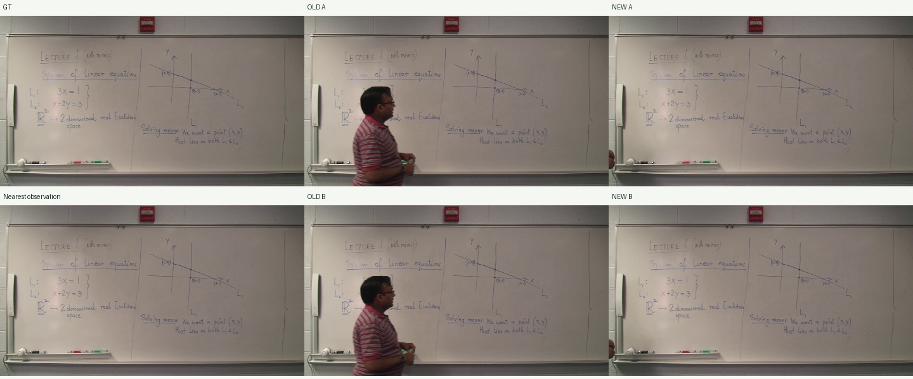
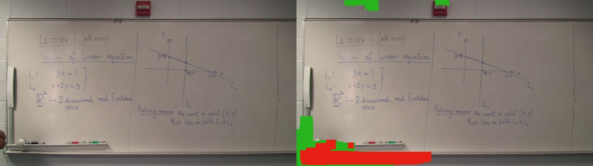

# AccessMath 판서 선택·복원 개선

**A의 잘못된 대표 선택은 실제 영상에서 개선됐습니다. B는 불확실한 합성을 거부하도록 강화했지만, 실제 영상의 복원 성공은 입증하지 못했습니다.** 이전 기준선은 그대로 보존했고 새 결과는 `experiments/accessmath-improvement/`에 저장했습니다.

## 같은 계약으로 측정한 전후 결과

| 입력 | 방법 | Recall | Precision | F1 |
|---|---|---:|---:|---:|
| Lecture 01 part 1 · training · GT 3개 | 이전 A | 96.42% | 74.24% | 83.28% |
| 동일 | 이전 B | 96.42% | 74.24% | 83.28% |
| 동일 | 새 A | 99.51% | 94.17% | **96.77%** |
| 동일 | 새 B | 99.51% | 94.17% | **96.77%** |
| Lecture 02 전체 · testing · GT 10개 | 이전 A | 100.00% | 99.83% | 99.91% |
| 동일 | 이전 B | 100.00% | 99.83% | 99.91% |
| 동일 | 새 A | 99.99% | 99.83% | 99.91% |
| 동일 | 새 B | 99.99% | 99.83% | 99.91% |

표는 기존 임계값 10, 키프레임별 macro 평균입니다. Training F1은 **+13.4848%p**입니다. Testing의 반올림 전 F1은 **99.913064% → 99.912323%**로, 변화는 **−0.000741%p**였습니다. 기존 방법도 검은 필기가 뚜렷한 Lecture 02에서는 잘 작동했습니다. 테스트셋에서 개선했다고 주장하거나 통계적 동등성을 입증한 것으로 해석하지 않습니다.

Lecture 01은 1080p/17분26초/2,090개 관측, Lecture 02는 1080p/**43분19초 전체**/5,194개 관측입니다. Lecture 02는 공식 testing 분할이며 내려받은 영상 SHA-256은 `4cd2a3c6428baca918a72c0b43d5b4926d3eeca9145ece5059038e8cb9b19773`입니다. 평가를 보지 않은 상태에서 수정 A와 B의 판단 규칙을 정했고, testing 점수를 본 뒤 규칙을 조정하지 않았습니다. 중간에 추가한 상태별 체크포인트는 재개 기능이며 예측을 바꾸지 않습니다.

공식 GT는 평가에만 사용했습니다. `annotations`, `predicted_ink`, `score` 함수의 AST 해시가 기존과 같은지 검사했습니다. 31×31 black-hat, 임계값 10/20/30, 3픽셀 허용, 비판서 영역 제외, GT 원본의 이진화 기준값을 유지했습니다. 평가 코드 변경은 강의 이름/testing 표시 및 스트레스 테스트 설명 등 메타데이터입니다. **공식 unique-CC 벤치마크 점수는 아닙니다.** 원본 해상도와 관측 시각도 같습니다.

## 607초 원인 추적과 수정

이전 `analyze.close()`는 다음 튜플이 가장 작은 후보를 골랐습니다.

```python
(round(global_foreground_fraction, 3), -whole_image_laplacian_variance, -time)
```

가림 비율이 선명도보다 절대적으로 우선했습니다. 깨끗한 **607.607초**는 추정 가림 **43.32%**, 선명도 236.02로 **33개 중 29위**였고, 교수자가 가린 **616.1155초**는 추정 가림 **39.47%**, 선명도 223.23으로 **1위**였습니다. 선명도가 높아서 잘못 골랐던 사례는 아닙니다.

단일 중앙 색과 28 이상 다른 픽셀의 연결 요소에 두꺼운 부분이 하나라도 있으면 연결 요소 전체를 가렸습니다. 조명 변화로 넓은 칠판 영역이 전경이 됐고, 사람과 연결된 필기도 같은 마스크에 들어갔습니다. 교수자가 들어오면서 이 잘못된 마스크 면적이 오히려 줄었습니다. 또한 중앙 밝기 127의 화이트보드를 `median > 140` 규칙이 blackboard로 판정했습니다.

수정은 기존 모듈 안에서 수행했습니다.

- 프레임별 공간 조명을 6항 표면으로 강건 추정하고, 두꺼운 색 이탈의 **국소 핵**만 팽창시켜 가림을 추정합니다. 사람과 닿은 필기 연결 요소 전체를 마스킹하지 않습니다. 이 표면은 분석용이며 출력 픽셀을 생성하지 않습니다.
- 가는 필기의 국소 어둠/밝음 방향으로 유형을 판별합니다. 절대 밝기는 필기가 없는 저신뢰 상황의 보조값입니다.
- 상태 내 반복 관측된 필기 지지 영역에서 후보가 실제로 드러내는 비율을 계산하고, 가림·움직임을 벌점으로 사용합니다. 임의의 검출 픽셀 수를 최대화하지 않습니다. 선명도는 필기 영역에서만 작은 보조값으로 사용합니다.
- 각 후보의 점수·필기 지지율·가림·움직임·필기 선명도를 JSON에 저장하고, 상위 5개 후보도 유지합니다.

같은 이전 33개 후보 집합을 고정하면 607.607초는 **새 순위 12위**, 616.1155초는 **27위**가 됩니다. 새 점수는 각각 0.75154, 0.67195입니다. 그 집합의 새 1위는 필기가 드러난 **603.1025초**입니다. 실제 새 상태에서도 이 원본을 선택했습니다. GT에 가장 가까운 시각을 강제로 선택하지 않았습니다.

607.674초 GT의 A F1은 **73.2653% → 96.3209%**, 다른 730.530초 GT도 **79.3263% → 96.7705%**로 개선됐습니다.



[후보 전부와 실제 순위 HTML](../experiments/accessmath-improvement/diagnosis/candidates-607.html), [JSON](../experiments/accessmath-improvement/diagnosis/candidates-607.json), [마스크 전후 이미지](../experiments/accessmath-improvement/diagnosis/selection-before-after.jpg)를 남겼습니다.

## 상태 분할과 이동 판정

이전에는 약한 파란 필기가 640픽셀 축소 및 대비 23 임계값에서 잘 검출되지 않았고, 넓게 잘못 가려진 영역이 비교에서 제외됐습니다. 미확정 변화의 오래된 `pending_start`가 나중의 다른 변화까지 소급할 수도 있었습니다.

현재는 대비 8의 관측에 기존 2회 지속 확인과 1픽셀 경계 허용을 적용하고, 확정된 연속 관측의 시작 시점에서 경계를 만듭니다. 이전 whiteboard 상태 **606.1055~670.670초**, 대표 663.1625초가 그대로 재현되지 않습니다. 새 607초 상태는 **589.589~652.1515초**이고, 그 뒤 652.1515/653.1525/654.1535/655.1545/666.1655/669.669초에서 구분됩니다. 663초의 갱신 구간을 607초 대표로 배정하지 않습니다. 오래 유지된 상태 자체를 실패라고 보지는 않습니다.

전체 상태 수는 training 141→266, testing 644→712입니다. 중간 상태를 더 보존하지만, **상태 수 증가를 품질 개선 지표로 사용하지 않았습니다.** 실제 중간 필기 전부의 수동 정답 평가는 남아 있습니다.

이동 후보는 전체 위상 상관만으로 확정하지 않습니다. 가림을 뺀 ORB 대응점에서 공간적으로 퍼진 RANSAC 배경 변환을 확인합니다. Training의 이동 판정은 19→1개로 줄었습니다. 남은 20.5205초는 배경 대응 228개/인라이어 203개, 화면 폭 91.6%·높이 84.2%에 걸친 변환으로 수평 약 7.24 분석 픽셀의 이동을 지지합니다. 이전 상단 영역 진단도 이 지점의 이동을 지지했습니다. 별도 수동 카메라 이동 GT가 없으므로 오검출률 0%로 주장하지 않습니다. 지속적인 줌·이동 보정은 여전히 지원하지 않습니다.

Training의 자동 유형은 blackboard 2,087개에서 **whiteboard 2,090개**로 바뀌었고, testing도 5,194개를 whiteboard로 판정했습니다.

## B 정책과 실제 한계

B는 먼저 좋은 원본을 유지합니다. 합성이 필요하면 같은 상태의 시간상 가까운 후보에서 공동으로 보이는 필기의 일치를 검사하고, 충돌하는 원본을 제외합니다. 대상 가림 영역은 서로 다른 두 시점에서 실제로 드러나야 합니다. 32픽셀 타일이 안전하지 않으면 작은 영역으로 나누되, 근거가 없는 전경을 남긴 채 복원 성공으로 표시하지 않습니다. 합성 후 전경 잔상과 기존 가시 필기의 소실도 검사합니다. 각 거부 사유·원본 ID·두 시점 관측 비율을 저장합니다.

다른 상태의 이미지는 고정된 경계 물체의 **마스크 빈도** 추정에만 사용합니다. 다른 상태의 필기 픽셀은 합성에 사용하지 않습니다. 실제 출력 출처와 마스크 문맥 출처는 분리했습니다. 동일 상태 안의 작은 미검출 갱신 위험도 있어 원본 간 필기 일치 및 12초 거리 제한을 함께 적용합니다.

실제 결과는 training **266개**, testing **712개 모두 원본 제공**입니다. 이전의 부분 합성 84/263건을 복원 성공으로 취급하지 않았습니다. 따라서 새 B의 실제 GT 지표는 새 A와 같으며, **실제 강의의 가림 복원 성공을 입증하지 못했다는 한계가 남습니다.** 단순히 B를 끈 것은 아니며, 충분한 관측이 있는 합성 입력에서는 실제로 합성됩니다.

실제 가림 검증도 따로 수행했습니다. GT를 읽지 않는 규칙으로 상태를 고르고, 깨끗한 원본을 제외한 **38개 실제 가림 관측 집합**을 같은 순위 규칙으로 처리했습니다. 또 긴 상태 8개에서 가림이 가장 큰 관측을 고정한 앵커 테스트를 했습니다. 이들은 일반 앱 A 점수와 구분되는 스트레스 테스트입니다. 모두 원본으로 돌아갔습니다. 607초 상태의 순위 기반 가림 입력에서는 대상 14,907 분석 픽셀 중 두 시점 이상에서 드러난 영역이 5,661픽셀뿐이었고 9,246픽셀은 그 조건을 만족하지 못했습니다. 최대 가림 앵커의 해당 GT F1은 A/B 모두 54.41%로 복원하지 못했습니다.



색은 가림 영역에서 초록=두 시점 관측 충족, 빨강=부족입니다. 물리적으로 정보가 절대 없다는 뜻은 아니며, 이 테스트의 제한된 후보·마스크·거리 조건에서 확인하지 못한 영역입니다.

## 성공·악화·실패를 구분한 시각 검증

- **실제 A 개선:** 607초 및 730초 비교는 위와 종합 HTML에 있습니다.
- **실제 A의 작은 회귀:** 347.781초 F1은 97.2519%→97.2064%로 **−0.0455%p**입니다. testing도 일부 키프레임에서 소폭 하락했습니다. 13개 GT의 전후 수치와 이미지 전부를 공개했습니다.
- **기존 B의 실제 악화:** 이전 whiteboard 별도 기준선의 607초에서 A F1 62.6427%→B 62.6192%였고 교수자 잔상이 남았습니다. [이미지](../experiments/accessmath-improvement/diagnosis/legacy-b-regression.jpg)는 이 과거 실패이며 새 B의 성공으로 표시하지 않았습니다.
- **새 B의 합성 성공은 합성 영상에서 확인:** 동일한 입력 SHA의 가림 영상에서 A 회수율 64.85%, 이전 B 82.65%, 새 B **100%**였습니다. 정보가 한 번도 보이지 않는 영상은 14.07%인 원본을 유지했습니다. 이 합성 지표는 기존 색상 픽셀 회수율이며 AccessMath의 R/P/F1과 합치지 않습니다.

[합성 비교](../experiments/accessmath-improvement/synthetic/index.html), [실제 가림 관측 테스트](../experiments/accessmath-improvement/occlusion-evaluation/index.html), [최대 가림 앵커 테스트](../experiments/accessmath-improvement/occlusion-anchor-evaluation/index.html)를 각각 저장했습니다. 새 B는 실제 합성을 승인하지 않아 실제 승인 결과의 악화 사례도 없습니다. 부족한 성공 근거를 만들기 위해 조건을 낮추지 않았습니다.

## 코드·재현·검증

주요 변경은 [vision.py](../lecture2doc/vision.py)의 조명/가림·유형·후보 순위·상태 경계·배경 이동 검증, [reconstruct.py](../lecture2doc/reconstruct.py)의 원본 우선/관측 일치/출처 및 거부 정책입니다. [pipeline.py](../lecture2doc/pipeline.py)는 후보 대안 저장과 상태별 복원 체크포인트만 확장했습니다. 파이프라인 전체를 재작성하거나 새 신경망·의존성을 추가하지 않았습니다. CPU 실행이며 Intel 268V의 속도를 실측한 것은 아닙니다.

```bash
source .venv/bin/activate
python scripts/diagnose_selection.py
python scripts/run_quality.py --video datasets/accessmath/AccessMath_lecture_01_part_1.mp4 \
  --decode-from experiments/accessmath/lecture01_part1 --out experiments/accessmath-improvement/v4/auto
python scripts/accessmath_evaluate.py --record experiments/accessmath-improvement/v4/auto \
  --out experiments/accessmath-improvement/v4/evaluation

# Testing 원본: scripts/accessmath_fetch.py --url 공식URL --out datasets/accessmath/AccessMath_Lecture_02.mp4
python scripts/run_quality.py --baseline --video datasets/accessmath/AccessMath_Lecture_02.mp4 \
  --out experiments/accessmath-improvement/heldout/baseline
python scripts/run_quality.py --video datasets/accessmath/AccessMath_Lecture_02.mp4 \
  --decode-from experiments/accessmath-improvement/heldout/baseline \
  --out experiments/accessmath-improvement/heldout/revised
python scripts/accessmath_evaluate.py --record experiments/accessmath-improvement/heldout/revised \
  --gt datasets/accessmath/annotations/data/annotations/AccessMath2015_lecture_02 \
  --split testing --out experiments/accessmath-improvement/heldout/evaluation-revised
python scripts/quality_report.py
python -m pytest -q
```

변경 전 testing 실행은 보존한 원본 `vision.py`/`reconstruct.py`를 별도 모듈로 불러 사용했습니다. 디코딩은 동일한 원본 해시와 PTS 캐시를 재사용했습니다. 원래 `experiments/accessmath/` 기준선의 manifest·평가 JSON 해시와 평가 함수 AST 해시를 다시 검사해 변하지 않았음을 확인했습니다.

자동 검증은 판서 상태 순도·PTS·원본 출처·가변 FPS·실패 독립성에 더해, 어두운 화이트보드/그늘, 줄무늬 전경보다 읽히는 원본 우선, 사람 움직임과 실제 이동 구분, 작은 갱신의 충돌, 중단 후 체크포인트 재개를 확인합니다. **테스트 통과를 품질 향상의 증거로 사용하지 않았습니다.** 실제 품질 근거는 위 정량 지표와 시각 결과입니다. 실제 Chromium에서도 607초 영상 이동, 결과 이미지, 후보 진단표와 비교 보고서를 확인했습니다.

최종 전체 테스트는 **23 passed**이며 [원문 출력](../experiments/accessmath-improvement/tests-final-23.txt)에 저장했습니다. [무결성 검사](../experiments/accessmath-improvement/final-integrity.json)도 함께 남겼습니다.

최종 testing 복원은 한 번 프로세스 종료로 중단돼 완료로 보고하지 않고 재실행했습니다. 상태별 체크포인트를 추가한 뒤 712개를 끝까지 처리했습니다. 종료 원인은 확인되지 않았습니다.

## 산출물

- [종합 HTML](../experiments/accessmath-improvement/index.html), [전후 수치 JSON](../experiments/accessmath-improvement/summary.json)
- [607초 후보·순위·근거](../experiments/accessmath-improvement/diagnosis/candidates-607.html)
- [testing GT 10개 비교](../experiments/accessmath-improvement/heldout/evaluation-revised/index.html)
- [원래 기준선 보존 해시](../experiments/accessmath-improvement/preserved-baseline.json), [평가 계약 해시](../experiments/accessmath-improvement/evaluation-contract.json)
- [웹 뷰어 캡처](../experiments/accessmath-improvement/viewer-after-607.png)

결과는 [종합 비교 HTML](../experiments/accessmath-improvement/index.html)과 [607초 후보·선정 근거](../experiments/accessmath-improvement/diagnosis/candidates-607.html)에서 확인할 수 있습니다. 수치는 두 강의의 GT 13개를 사용한 평가 범위입니다.
